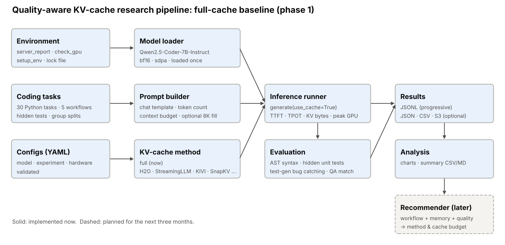

# Quality-Aware KV-Cache Optimization for Long-Context LLM Coding Workloads

**Phase 1: full KV-cache baseline pipeline on AWS SageMaker** (first review: 1 December 2026).

This repository loads `Qwen/Qwen2.5-Coder-7B-Instruct`, runs 30 Python coding tasks with the
**standard full KV cache**, measures latency (TTFT, TPOT, total), GPU memory and actual KV-cache
bytes, scores the answers by executing hidden unit tests, and writes JSON, CSV and charts.

> This is a **baseline**, not a compression benchmark. No compression method has been run, so
> no memory reduction or quality retention is reported anywhere. 30 samples demonstrate the
> pipeline; they are not statistically conclusive.



## What has been verified, and where

| Check | Where | Status |
|---|---|---|
| Unit tests (evaluation, configs, results, charts, inference plumbing, position sweep, LongCodeU loader + metrics) | CPU, Python 3.13, transformers 5.24 and 4.46 | 42 passed, 2 GPU-only tests skipped |
| End-to-end run of all 30 tasks | CPU, tiny **random-weight** Qwen2-architecture model | runs, saves, evaluates, charts (output is gibberish by design) |
| Qwen2.5-Coder-7B on GPU | SageMaker, NVIDIA A10G (ml.g5.xlarge) | **done**: baseline_001, position sweep, LongCodeU 0~8K (see `results/`) |

A step-by-step walkthrough of the pipeline is in [docs/PIPELINE_WALKTHROUGH.md](docs/PIPELINE_WALKTHROUGH.md); the full research and module guide is in [docs/PIPELINE_EXPLAINED.md](docs/PIPELINE_EXPLAINED.md).

## Hardware plan (from your SageMaker quotas)

| Instance | GPU | Quota | Use |
|---|---|---|---|
| `ml.g6.xlarge` | NVIDIA L4, 24 GB, bf16 | 1 | **use this** (cheapest GPU you have) |
| `ml.g5.xlarge` | NVIDIA A10G, 24 GB, bf16 | 1 | fallback, a little faster, more expensive |
| `ml.g4dn.*` | T4, 16 GB, no bf16 | 0 | not available |

Why 24 GB is enough at 8K: Qwen2.5-Coder-7B has ~7.6 B parameters → **~14.2 GiB of bf16 weights**.
It uses grouped-query attention (28 layers × 4 KV heads × 128 dims), so the bf16 KV cache is
**56 KiB per token → ~0.45 GiB at 8K tokens**. With prefill activations the expected peak is
about 15–16 GiB. `scripts/check_gpu.py` prints this estimate; the real number comes from your run.
The model advertises 32K context (`max_position_embeddings`); 8K is the planned budget for now.

Both instances have only 16 GB of RAM, so the loader streams weights straight to the GPU
(`device_map="cuda"`, `low_cpu_mem_usage=True`).

## Costs and the free tier

- The AWS free tier **does not cover GPU instances**. `ml.g6.xlarge` is billed per second while
  the space is running, roughly **$1 per hour** in us-east-1 (check the SageMaker pricing page
  for your region). The full demo (setup + download + 30-task run + long-context run + analysis)
  should take about 1.5–2 hours.
- Space storage (EBS) is billed per GB-month even while stopped: use **50 GB**, not more.
- S3 for results is a few MB: negligible.
- Nothing in this repo creates endpoints, training/processing jobs, buckets or instances.

## Run it on SageMaker

### 0. Create the space (once)
SageMaker Studio → **JupyterLab** (or Code Editor if that is where your quota is) → *Create space* →
instance **ml.g6.xlarge**, storage **50 GB** → *Run space* → *Open*.

### 1. Get the code and set up (~5 min)
In a Studio terminal:
```bash
git clone https://github.com/<you>/<repo>.git kv_cache_research
cd kv_cache_research
bash setup_env.sh                 # inspects first, installs only what is missing, writes requirements-lock.txt
export HF_TOKEN=hf_xxx            # your token; never commit it. Qwen2.5-Coder is not gated, so optional.
export HF_HOME=$HOME/hf_cache     # keep the 15 GB model cache on the persistent volume
```

### 2. Either run the notebooks in order
| Notebook | Does | Time |
|---|---|---|
| `notebooks/01_environment_setup.ipynb` | nvidia-smi, versions, disk, `results/server_report.json`, feasibility, CPU tests | 5 min |
| `notebooks/02_model_loading.ipynb` | download, load Qwen-7B, chat template, **first coding inference**, model tests | 15 min (download) |
| `notebooks/03_full_cache_baseline.ipynb` | 3-sample check, 30-task baseline, optional 8K run, position sweep, LongCodeU | 15 min – 3 h |
| `notebooks/04_result_analysis.ipynb` | charts, summary, position + LongCodeU charts, S3 copy, shutdown checklist | 2 min |

Shut down notebook 02's kernel before starting 03 (two copies of the model do not fit in 24 GB).

### 2'. Or the same thing from the terminal
```bash
python main.py report                       # -> results/server_report.json
python main.py check-gpu                    # GPU + 7B feasibility estimate
python main.py download                     # model weights into $HF_HOME
python main.py first                        # one task end to end -> results/json/first_inference.json
python main.py run --max-samples 3 --experiment-id smoke_3      # quick check
python main.py run --experiment-id baseline_001                 # 30 tasks, 8K budget, 256 new tokens
python main.py analyze --experiment-id baseline_001             # charts + summary
python main.py run --config configs/experiment_longctx.yaml     # optional: prompts padded to ~8K
python main.py analyze --experiment-id baseline_longctx_8k_d50
python main.py position && python main.py analyze-position      # position sensitivity sweep
KVR_TEST_MODEL=Qwen/Qwen2.5-Coder-7B-Instruct python -m pytest tests -v   # all 7 test groups on the real model
```
Long runs survive a closed browser tab with
`nohup python main.py run --experiment-id baseline_001 > results/raw_logs/baseline_001.log 2>&1 &`.
If anything stops, re-run with `--resume`; finished samples are kept.

### 3. Save results and shut down (do not skip)
```bash
export KVR_S3_BUCKET=<your existing bucket>   # optional; the script never creates buckets
python main.py s3 --dry-run && python main.py s3
git add results requirements-lock.txt && git commit -m "SageMaker baseline results" && git push
```
Then: shut down all kernels → Studio → your space → **Stop**. Closing the tab does not stop billing.
Check that SageMaker → Inference → Endpoints is empty.

## If 8K does not fit (follow in order, and label results)
1. Read `peak_allocated_gpu_bytes` and the `oom` rows in the CSV.
2. `model.dtype: float16` (same memory as bf16; only if bf16 misbehaves).
3. `WITH_BNB=1 bash setup_env.sh`, then `--quantization 4bit`, and a **new** `--experiment-id`.
4. Smaller model for pipeline debugging: `--model Qwen/Qwen2.5-Coder-1.5B-Instruct --experiment-id fallback_001`.
   Charts and summaries are automatically labelled *PRELIMINARY* for anything other than bf16 Qwen-7B.

## Position sensitivity (Lost-in-the-Middle), full cache
```bash
python main.py position                        # 0/25/50/75/100 % at ~8K tokens, 30 tasks, model loaded once
python main.py analyze-position                # results/charts/position_full_correctness_by_position.png
```
Each task's code is embedded in unrelated synthetic Python at the given relative position (the
position test from the project plan). With the full cache this gives the reference curve; later each
compression method reruns the same sweep, so position-dependent loss can be compared directly.
Use `--max-samples 10` or `--depths 0 0.5 1` if GPU time is short.

## LongCodeU subset (real long code), full cache
[LongCodeU](https://arxiv.org/abs/2503.04359) (Li et al., ACL 2025) has 8 long-code-understanding tasks built from
116 real Python repositories: code unit perception (CU_P), semantic analysis (CU_SA), data-flow analysis (CU_DFA),
dependency relations (DRA_T1/T2), semantic relations (SRE_T1/T2) and documentation (LDU). The dataset is on the Hub as
[`longcodeu/longcodeu-dataset`](https://huggingface.co/datasets/longcodeu/longcodeu-dataset), licence **Apache-2.0**
(per its card; the code inside comes from public repositories). It is downloaded on the instance, not committed.
```bash
python main.py prepare-longcodeu --inspect --tasks CU_P      # look at one raw record first
python main.py prepare-longcodeu                             # 10 per task from the 0~8K bucket that fit 7,680 prompt tokens
python main.py run --config configs/experiment_longcodeu.yaml   # 512 new tokens, prompts used verbatim, never truncated
python main.py analyze --experiment-id longcodeu_8k_full     # adds a score-by-task chart
```
Scoring follows the paper's metric descriptions (LCS recall/precision for CU_P, exact-match lines for CU_DFA,
CodeBLEU for CU_SA, per-unit CodeBLEU recall/precision for DRA/SRE, BLEU for LDU). The official scoring code was
not available to compare against, so treat these as faithful re-implementations: comparable across this
project's runs (full cache vs compressed), not necessarily to the paper's tables. Most LongCodeU inputs are far
longer than 8K (paper average ~55K tokens). This subset uses the 0~8K bucket to match the 8K baseline budget.
The 8~16K bucket should still fit a 24 GB GPU with the full cache (`--bucket 8~16K --max-prompt-tokens 15872`
and `context_length: 16384`); 32K is borderline, and beyond that is where compression becomes necessary.

## Research framing (from the project plan)
Base paper: Yuan et al., *KV Cache Compression, But What Must We Give in Return?* (EMNLP 2024 Findings),
which benchmarks KV-cache compression on LongBench and Needle-in-a-Haystack. This project narrows it to
long-context **coding** workloads and adds position sensitivity and a recommendation step.
Comparison formulas, ready for the first compressed run (`evaluation/comparison.py`):

| | Formula |
|---|---|
| Quality retention | QR = Q_compressed / Q_full × 100 |
| Memory reduction | MR = (M_full − M_compressed) / M_full × 100 |
| Compression ratio | CR = M_full / M_compressed |
| pass@1 (greedy) | correct code tasks / all code tasks (failed and OOM runs count as wrong) |

They are not reported for the baseline, because there is nothing to compare yet.

## Configuration
- `configs/model_config.yaml`: model, revision, dtype, attention, quantization, fallback model.
- `configs/experiment_config.yaml`: experiment id, workflow filter, `cache_method: full`, context length 8192,
  256 new tokens, batch 1, greedy (`do_sample: false`, `repetition_penalty: 1.0` overriding Qwen's 1.05 default),
  overflow policy (skip or truncate, always recorded), optional long-context fill, dataset split, S3 target.
- `configs/hardware_config.yaml`: the VRAM planning rules and the instances in your quota.
All values are validated (`utils/config.py`); planned-but-unimplemented cache methods are rejected by name.

## Dataset
`datasets/sample_tasks.json`: 30 custom tasks written for this project (no licence issues), 6 per workflow:

| Workflow | Task type | Scored by |
|---|---|---|
| completion | implement a function/class from its docstring | hidden unit tests |
| debugging | fix a planted bug | hidden unit tests (the buggy version is verified to fail them) |
| testgen | write pytest tests | tests must pass on the correct code **and** fail on 2 planted bugs |
| longcode | explain a module / predict an output | keyword coverage (explanations) or answer match |
| repoqa | multi-file repository questions | answer match, keyword coverage |

Only `task` and `context` reach the model; a test checks that no hidden field leaks into prompts.
Splits are by `group_id` (variants of one task stay in one split): 16 train / 5 validation / 9 test.
Regenerate with `python datasets/build_sample_tasks.py`.

## Metrics and how they are measured
| Field | Meaning |
|---|---|
| `input_tokens`, `output_tokens` | prompt tokens after the chat template; generated tokens (incl. the end-of-turn token) |
| `total_inference_seconds` | `model.generate()` only, CUDA-synchronised `perf_counter`. Excludes model loading, tokenisation and decoding |
| `ttft_seconds` | start of `generate()` → first new token exists (per-step timestamps via a no-op `StoppingCriteria`) |
| `tpot_ms` | (end − first-token time) / (output_tokens − 1); `null` for one-token outputs |
| `prefill_time_seconds` | separate prefill-only forward over the same prompt (excluded from total) |
| `kv_cache_bytes` | bytes of the tensors in the cache object `generate()` returns (measured, not estimated) |
| `kv_cache_bytes_theoretical_full` | architecture formula, for checking; equal to the measured value for the full cache |
| `peak_allocated_gpu_bytes`, `peak_reserved_gpu_bytes` | `torch.cuda.max_memory_allocated/reserved` over generate (weights included) |
| `syntax_valid` | `ast.parse` of the extracted code |
| `functional_correctness`, `unit_test_pass_rate` | hidden tests run in a separate isolated Python process with timeout and memory limit |
| `status` | `ok`, `oom`, `context_overflow`, `tokenizer_error`, `inference_error`, `model_load_failed`, `invalid_sample` |

Unavailable values are `null` (e.g. GPU memory on CPU), never estimated.

## Layout
```
main.py                  one entry point (report | check-gpu | download | first | run | analyze | s3 | demo)
setup_env.sh             inspect-then-install, writes requirements-lock.txt
configs/                 model / experiment / long-context / hardware YAML
datasets/                sample_tasks.json + builder; prepare_longcodeu.py -> processed/longcodeu_8k.json
models/model_loader.py   tokenizer + model, loaded once
inference/               prompt building, context budget, timed full-cache generation
cache_methods/           CacheMethod interface; "full" implemented, six methods registered as planned
evaluation/              correctness (AST + execution), memory, latency, text-quality, LongCodeU metrics, QR/MR/CR/pass@1
scripts/                 server_report, check_gpu, download_model, baseline_inference, run_experiments,
                         analyze_results, run_position_sweep, analyze_position, sync_to_s3, build_notebooks
notebooks/               01–04 (generated by scripts/build_notebooks.py)
results/                 raw_logs/ (JSONL, progressive)  json/  csv/  charts/
tests/                   test_gpu, test_model, test_inference, test_evaluation, test_results
kivi_baseline/           earlier FP16-vs-KIVI harness on Llama-3.1-8B (see below)
docs/                    architecture diagram, ROADMAP.md
```

## The earlier KIVI baseline (`kivi_baseline/`)
The FP16-vs-KIVI (2/4-bit) harness built before this pipeline is kept unchanged in
`kivi_baseline/`. It needs its own conda env (KIVI pins torch 2.4.1 + transformers 4.43.1 and a
custom CUDA kernel) and Llama-3.1-8B licence approval; see `kivi_baseline/README.md`. It runs on the
same `ml.g6.xlarge`. Its synthetic-code haystack generator is reused here for the long-context fill,
and it is the reference for adding KIVI as a `cache_methods/` entry (see `docs/ROADMAP.md`).
Keep its results separate: different model (Llama-3.1-8B), fp16, and a needle-retrieval task.

## Known limitations
- No compression method has been run yet; all GPU results are full-cache baselines.
- 30 hand-written tasks are short (a few hundred tokens each) unless padded with the long-context config; the
  padding is synthetic code, so it tests position sensitivity, not real repository understanding.
- The position sweep uses synthetic filler code, so it measures retrieval of the task code by position, not real cross-file reasoning.
- LongCodeU metrics are re-implemented from the paper's descriptions (official scorer not checked) and only the 0~8K bucket is used.
- Explanation tasks are scored by keyword coverage and token F1, which are rough; no LLM judge yet.
- Code execution uses a subprocess with time/memory limits, not a security sandbox.
- TTFT/TPOT timestamps add a CUDA sync per step (small, identical for all future methods).
- Peak memory includes the 14 GiB of weights; at batch 1 and 8K the KV cache is a small share,
  which is why later compression experiments need longer contexts or larger batches to show effects.

## Next steps
See [docs/ROADMAP.md](docs/ROADMAP.md): StreamingLLM and SnapKV first, then H2O, PyramidKV, KIVI
(ported from `kivi_baseline/`), EvolKV; public benchmarks after licence checks; position
sensitivity per method (the full-cache sweep exists); Pareto analysis; then the recommender.
