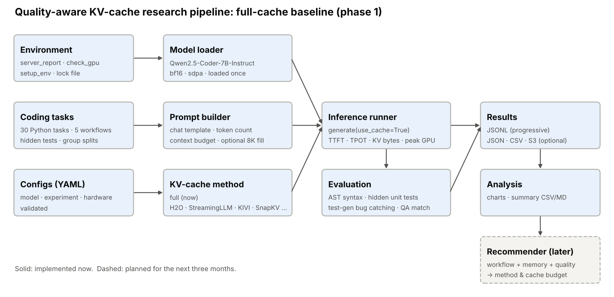

# The pipeline, explained from start to finish

This guide covers everything built and run so far in **Quality-Aware KV-Cache Optimization for
Long-Context LLM Coding Workloads**. It explains what each part does, why it exists, what was
measured, and what the numbers mean. Read it top to bottom once. After that, use section 1 (the
2-minute version) and section 12 (likely questions) to explain it to someone else.

Status on 23 November 2026: the **full KV-cache baseline is finished**. All three experiments ran on a
real GPU on AWS SageMaker, and the results are in `results/`. **No compression method has been run
yet.** That is the next phase.

---

## 1. The 2-minute explanation

> When a large language model (LLM) generates text, it stores a "memory" of every token it has
> already read. This memory is called the **KV cache** (Key/Value cache). It grows linearly with the
> length of the input. For long code inputs (whole files or repositories) it becomes a major cost in
> GPU memory and speed. Many papers propose ways to **compress** the KV cache (drop unimportant tokens,
> or store them in fewer bits). They mostly test on general text, not on code.
>
> My project asks: **how much coding quality do we lose when we compress the KV cache, and which
> method should a developer use for which coding task?**
>
> Before we can measure loss we need a reference point. Phase 1 builds that: an automated pipeline
> that runs **Qwen2.5-Coder-7B-Instruct** with the **normal, uncompressed (full) KV cache** on an
> NVIDIA A10G GPU on AWS SageMaker. It measures speed (time to first token, time per token), GPU
> memory and the exact KV-cache size, and it checks whether the generated code is correct by
> **actually running it against hidden unit tests**.
>
> I ran three experiments:
> 1. **30 custom coding tasks** across 5 workflows (completion, debugging, test generation, long-code
>    understanding, repository Q&A). Result: pass@1 is 61%, and every sample ran without error.
> 2. **A position test.** The real task code is hidden inside about 7,600 tokens of unrelated code at the
>    start, 25%, 50%, 75% or end. This checks whether the model loses information depending on where it sits.
> 3. **80 samples from LongCodeU**, a published long-code-understanding benchmark (ACL 2025), with
>    inputs of about 4,500 tokens. Mean score: 0.52. The model is good at finding and reproducing code
>    units and weakest at reasoning about relations *between* functions.
>
> Every compression method (StreamingLLM, SnapKV, H2O, PyramidKV, KIVI, EvolKV) will now plug into the
> same pipeline and be compared against these numbers. I'll use **quality retention** and **memory
> reduction** to measure each one.

---

## 2. Background you need to explain it

### 2.1 What the KV cache is
A transformer reads the prompt in one pass (**prefill**) and then generates the answer one token at
a time (**decode**). In every layer, each token produces a **Key** vector and a **Value** vector.
New tokens must "attend" to all previous keys and values. To avoid recomputing them every step, the
model keeps them in GPU memory. That is the **KV cache**.

Its size is

```
KV bytes = 2 (K and V) × layers × KV heads × head dimension × tokens × bytes per number
```

For Qwen2.5-Coder-7B: 28 layers, 4 KV heads (it uses *grouped-query attention*), head dimension 128,
bf16 (2 bytes):

```
2 × 28 × 4 × 128 × 2 bytes = 57,344 bytes = 56 KiB per token
8,000 tokens ≈ 0.44 GiB      32,000 tokens ≈ 1.75 GiB      (per sequence)
```

The pipeline **measures** the real bytes in the cache object after each run. It also computes this
formula as a check, and the two match exactly for the full cache.

### 2.2 Why compress it
For long inputs, many users (batch size above 1), or smaller GPUs, the KV cache can exceed the model
weights. Compression methods shrink it in one of two ways:
- **Eviction (dropping tokens):** StreamingLLM, H2O, SnapKV, PyramidKV, EvolKV.
- **Quantization (fewer bits per number):** KIVI (2-bit or 4-bit).

Both can hurt quality. Code is unforgiving: one missing variable name breaks the program. That is
the research gap this project addresses.

### 2.3 Base paper
Yuan et al., *KV Cache Compression, But What Must We Give in Return? A Comprehensive Benchmark of Long
Context Capable Approaches* (EMNLP 2024 Findings). It benchmarks compression methods on general long-context
tasks (LongBench, Needle-in-a-Haystack). This project narrows that idea to **coding workloads**. It adds
**execution-based correctness**, a **position-sensitivity test** and, later, a **recommendation step**.

---

## 3. What was built: architecture



The flow for one experiment is:

```
config YAML ──► load model once ──► for each task:
                                       build prompt (chat template)
                                       check it fits the 8K budget
                                       [optional] pad with filler code (position test)
                                       generate with the full KV cache, timing every token
                                       measure GPU memory and KV-cache bytes
                                       evaluate the answer (run tests / compare / score)
                                       append one result row (saved immediately)
                 ──► analyze: summary table + CSV + charts ──► [optional] copy to S3, push to GitHub
```

Key design decisions and why:

| Decision | Reason |
|---|---|
| Model loaded **once** per run | Loading takes about 3 minutes and 14 GiB. Reloading per task would waste GPU time |
| Results written **after every sample** (JSONL) | A crash or closed browser loses nothing, and `--resume` continues |
| **Greedy decoding** (no sampling, temperature 0, repetition penalty 1.0) | Same input gives the same output, so compressed runs can be compared fairly |
| Hidden tests **never** go into the prompt | A test checks this. Otherwise the model could copy the answers |
| Code runs in a **separate Python process** with a time and memory limit | A bad answer (infinite loop, huge allocation) cannot crash the pipeline |
| Compression methods are **registered but rejected** until implemented | A config can never silently fall back to the full cache and mislabel results |
| Failures are recorded as a **status**, not hidden | Every failure (`oom`, `context_overflow`, ...) stays in the data and counts as wrong |
| GPU-busy guard | Refuses to start if more than 2 GiB of GPU memory is already in use, so two runs can't collide |

---

## 4. Folder layout, and what each file does

```
kv_cache_research/
├── main.py                 single entry point for every command (section 8)
├── setup_env.sh            checks installed packages, installs only what is missing, writes requirements-lock.txt
├── requirements.txt        packages the pipeline needs
├── requirements-lock.txt   exact versions that were on the SageMaker machine (for reproducibility)
├── configs/                all settings as YAML (section 4.1)
├── utils/                  shared helpers
├── models/                 model loading
├── inference/              prompting and timed generation
├── cache_methods/          the KV-cache method interface (full cache now, 6 methods later)
├── evaluation/             all scoring and metrics
├── scripts/                the programs main.py calls
├── datasets/               the 30 custom tasks and the LongCodeU preparation script
├── notebooks/              01–04, the same steps as notebooks
├── tests/                  automated tests of the pipeline itself
├── results/                all outputs (raw logs, JSON, CSV, charts, summaries)
├── kivi_baseline/          the earlier FP16-vs-KIVI experiment, kept unchanged
└── docs/                   architecture diagram, ROADMAP.md, this guide
```

### 4.1 `configs/`
| File | Contents |
|---|---|
| `model_config.yaml` | Model `Qwen/Qwen2.5-Coder-7B-Instruct`, dtype auto (bf16 on A10G), attention `sdpa` (PyTorch's built-in fast attention), no quantization, fallback model Qwen2.5-Coder-1.5B |
| `experiment_config.yaml` | Main baseline: id `baseline_001`, cache method `full`, context 8,192 tokens, 256 new tokens, batch 1, greedy, overflow policy `skip`, prefill measurement on, warm-up on |
| `experiment_longctx.yaml` | Same tasks padded with filler code to about 7,680 tokens (used by the position test) |
| `experiment_longcodeu.yaml` | LongCodeU run: id `longcodeu_8k_full`, 512 new tokens, prompts used exactly as published |
| `hardware_config.yaml` | GPU memory planning rules and the instance types available in your AWS quota |

`utils/config.py` validates every value. For example, it rejects a context length that is too small or a
cache method that isn't implemented yet.

### 4.2 `utils/`
| File | Does |
|---|---|
| `config.py` | Loads and validates YAML configs, and applies command-line overrides |
| `paths.py` | One place for all folder paths |
| `dataset.py` | Loads task files, checks each sample has the required fields, filters by workflow and split |
| `results_io.py` | `ResultWriter`: appends each result to a JSONL log, then writes the final JSON and CSV (the last record per sample wins, which makes `--resume` safe) |
| `tiny_model.py` | Builds a tiny random-weight Qwen2-shaped model so the tests run on a CPU with no download |

### 4.3 `models/model_loader.py`
Loads the tokenizer and model once and streams the weights straight to the GPU (`device_map="cuda"`,
`low_cpu_mem_usage=True`). This matters because the instance has only 16 GB of RAM. It records model facts
(parameters 7.6 B, layers 28, KV heads 4, head dim 128, max context 32,768, load time, GPU memory used by
weights about 14.2 GiB). Optional 4-bit/8-bit quantization is available as a fallback but was **not** used.

### 4.4 `inference/`
| File | Does |
|---|---|
| `generation.py` | Builds the chat messages (system prompt + task + code context) and applies Qwen's chat template. Counts tokens and enforces the 8K budget (skip or truncate, always recorded). LongCodeU prompts are passed **verbatim** and never truncated. Runs `model.generate()` with a timing hook (section 6.1) |
| `inference_runner.py` | Loops over samples, catches errors per sample (out-of-memory, tokenizer error, ...), records memory, and hands the answer to the evaluator |

Compatibility detail: newer `transformers` versions renamed the cache argument (`past_key_values` →
`cache`). The code detects which name the installed version uses, so it works on both 4.x and 5.x.

### 4.5 `cache_methods/`
- `base.py` defines `CacheMethod`, the interface every method implements (`prepare`, `new_cache`,
  `generate_kwargs`, `describe`).
- `full.py` is **`FullCache`**, the standard uncompressed cache (HF `DynamicCache`). This is the only
  implemented method.
- `__init__.py` registers six **planned** methods: StreamingLLM, H2O, SnapKV, PyramidKV, KIVI and EvolKV.
  Asking for one raises a clear "not implemented yet" error.

### 4.6 `evaluation/`
| File | Does |
|---|---|
| `correctness.py` | Extracts code from the answer (from ```python blocks). Checks syntax with `ast.parse`. Runs hidden unit tests in an isolated subprocess (`python -I`, 10 s timeout, memory limit). Scores generated tests with real **pytest**. Recovers usable code from answers cut off at the token limit |
| `latency_metrics.py` | TTFT, TPOT, decode tokens per second |
| `memory_metrics.py` | Peak GPU memory, measured KV bytes, theoretical KV bytes |
| `quality_metrics.py` | Keyword coverage and token F1 for explanation answers, plus answer matching |
| `longcodeu_metrics.py` | LongCodeU scoring (section 5.3) |
| `comparison.py` | Quality retention, memory reduction, compression ratio and pass@1 (section 6.3), ready for compressed runs |

### 4.7 `scripts/`
| Script | Does |
|---|---|
| `server_report.py` | Writes `results/server_report.json`: SageMaker environment, region, OS, Python, package versions, GPU, disk |
| `check_gpu.py` | Shows the GPU and estimates whether the 7B model plus an 8K cache fits |
| `download_model.py` | Downloads the model weights into `$HF_HOME` |
| `baseline_inference.py` | One task end to end (the "first inference"), with a warm-up run first |
| `run_experiments.py` | The main runner: loads a config, loads the model, runs all samples, saves results |
| `run_position_sweep.py` | Runs the same 30 tasks at 5 positions, loading the model only once |
| `analyze_results.py` | Summary table, CSVs and 5 charts per experiment (plus a by-task chart for LongCodeU) |
| `analyze_position.py` | Position-test table and chart |
| `rescore.py` | Re-evaluates saved answers with the current scoring code, without using the GPU again |
| `show_failures.py` | Prints failed samples with the model's answer and the test error, for checking failures by hand |
| `sync_to_s3.py` | Copies `results/` to an **existing** S3 bucket (never creates one, and has a dry-run mode) |
| `build_notebooks.py` | Generates notebooks 01–04 |

### 4.8 `kivi_baseline/`
An earlier harness from before this pipeline, kept **unchanged**. It compares the FP16 KV cache with
**KIVI 2-bit and 4-bit** on **Llama-3.1-8B** at 8K/16K/32K (KV bytes, peak memory, prefill time, decode
speed and needle recall). It needs its own environment (KIVI pins torch 2.4.1 and transformers 4.43.1 and
builds a custom CUDA kernel). Two things from it are reused:
- its **synthetic Python code generator**, which makes the filler code for the position test;
- its KIVI setup, as the reference for adding KIVI to `cache_methods/` later.

Its results must be kept separate (different model, fp16, a retrieval task rather than coding).

---

## 5. The datasets

### 5.1 30 custom tasks (`datasets/sample_tasks.json`)
They were written for this project, so there are no licence problems. There are 6 tasks per workflow:

| Workflow | What the model must do | How it is scored |
|---|---|---|
| **completion** | Implement a function or class from its docstring | Hidden unit tests run on the code |
| **debugging** | Fix a planted bug | Hidden unit tests (the buggy version is checked to fail them) |
| **testgen** | Write pytest tests for given code | The tests must **pass** on the correct code **and fail** on 2 planted buggy versions |
| **longcode** | Explain a module or predict its output | Keyword coverage (explanations) or exact answer match |
| **repoqa** | Answer questions about a multi-file mini repository | Answer match / keyword coverage |

Each task has a `group_id`, so variants of one task stay in the same split (16 train / 5 validation / 9
test). This avoids leakage when a recommender is trained later. Only `task` and `context` are shown to
the model.

### 5.2 Position-test inputs
The same 30 tasks, with the task's code placed inside unrelated synthetic Python. The total is about **7,631
tokens**, and the real code sits at **0%, 25%, 50%, 75% or 100%** of the context. This is the
"lost in the middle" test: does the model miss information depending on where it is?

### 5.3 LongCodeU subset (`datasets/prepare_longcodeu.py`)
**LongCodeU** (Li et al., ACL 2025) is a long-code-understanding benchmark built from 116 real Python
repositories. The licence is Apache-2.0 and it is hosted on Hugging Face as `longcodeu/longcodeu-dataset`. It has 8 tasks:

| Task | Meaning | Metric used |
|---|---|---|
| CU_P | Code unit perception: list the functions in the code | LCS recall/precision over names |
| CU_SA | Semantic analysis: find the function that matches a description and return it | CodeBLEU |
| CU_DFA | Data-flow analysis: which lines affect a given variable | Exact-match lines (recall/precision) |
| DRA_T1 / DRA_T2 | Dependency relations: which functions a given function calls / depends on | Per-unit CodeBLEU + name recall/precision |
| SRE_T1 / SRE_T2 | Semantic relations: functions similar in meaning to a given one | Per-unit CodeBLEU + name recall/precision |
| LDU | Long documentation understanding: write documentation for code | BLEU-4 |

Preparation: from the **0–8K bucket**, take **10 samples per task (80 total)** whose prompt fits
7,680 tokens. A fixed random seed makes the selection reproducible. Files are downloaded one at a time,
because downloading the whole repository hit Hugging Face's rate limit (HTTP 429). The output
`datasets/processed/longcodeu_8k.json` is committed so the run can be repeated.

Note on scoring: the official LongCodeU scoring code was not available. These metrics are
**re-implemented from the paper's descriptions**. They are consistent across this project's runs (full
vs. compressed), but not guaranteed to match the paper's tables exactly. The first version of the
scorer misread the model's answer formats, for example `Function_names = [a, b]` and answers that give bare
function names. It was fixed, and the saved answers were re-scored without re-running the GPU (mean
0.22 → 0.52).

---

## 6. Metrics and formulas

### 6.1 Speed
| Metric | Definition |
|---|---|
| **TTFT** (time to first token) | From the start of `generate()` until the first new token exists. Measured by a no-op `StoppingCriteria` that timestamps every token, with a CUDA sync for accuracy. Dominated by **prefill** (reading the prompt) |
| **TPOT** (time per output token) | (time of last token − time of first token) / (output tokens − 1). The decode speed |
| **Total inference time** | `generate()` only. Excludes model loading, tokenization and decoding to text |
| **Prefill time** | A separate prefill-only forward pass over the same prompt (not counted in the total) |
| **Decode tokens/s** | 1 / TPOT |

A **warm-up** generation runs before the first timed sample. Without it, the first sample includes
one-time GPU start-up cost. This was a real bug seen in the first run (prefill 1.34 s, longer than the TTFT).

### 6.2 Memory
| Metric | Definition |
|---|---|
| **Measured KV-cache bytes** | Sum of all key/value tensors in the cache object returned by `generate()` |
| **Theoretical KV bytes** | The formula in section 2.1, used as a check |
| **Peak allocated / reserved GPU memory** | `torch.cuda.max_memory_allocated/reserved` during generation. It **includes the 14.2 GiB of model weights** |

### 6.3 Quality and comparison (`evaluation/comparison.py`)
| Formula | Meaning |
|---|---|
| **pass@1** = correct code tasks / all code tasks | Greedy, one attempt. Failed or OOM runs count as wrong |
| **Functional correctness** | Share of samples whose hidden tests all pass (only samples that *have* tests count) |
| **Quality retention** QR = Q_compressed / Q_full × 100 | How much quality a compression method keeps |
| **Memory reduction** MR = (M_full − M_compressed) / M_full × 100 | How much KV memory it saves |
| **Compression ratio** CR = M_full / M_compressed | Same idea as MR, expressed as a factor |

QR, MR and CR are **not reported yet**, because only the full cache has been run and there is nothing to compare.

---

## 7. Where and how it was run

| | |
|---|---|
| Platform | AWS SageMaker Studio, **Code Editor** space, region us-east-1 |
| GPU | **NVIDIA A10G**, 22 GiB usable (ml.g5.xlarge), bf16 supported |
| Software | Ubuntu 24.04, Python 3.13, PyTorch 2.12, CUDA 13.0, transformers 5.14 |
| Model | `Qwen/Qwen2.5-Coder-7B-Instruct`, bf16, sdpa attention, no quantization |
| Safety | Hugging Face token only via an environment variable and never committed. No AWS keys in code. No endpoints, training jobs or buckets created. The space is stopped after each session |

The exact package versions are in `requirements-lock.txt` and the machine details are in `results/server_report.json`.

---

## 8. Commands (`main.py`) and notebooks

| Command | What it does | Output |
|---|---|---|
| `python main.py report` | Environment report | `results/server_report.json` |
| `python main.py check-gpu` | GPU info + 7B/8K fit estimate | console |
| `python main.py download` | Download the model | `$HF_HOME` |
| `python main.py first` | One task end to end | `results/json/first_inference.json` |
| `python main.py run --experiment-id baseline_001` | 30-task baseline | raw log, JSON, CSV |
| `python main.py analyze --experiment-id baseline_001` | Summary + charts | `results/*_summary.md`, `results/csv`, `results/charts` |
| `python main.py position` / `analyze-position` | Position test + its chart | `position_full_*` files |
| `python main.py prepare-longcodeu` | Build the 80-sample LongCodeU subset | `datasets/processed/longcodeu_8k.json` |
| `python main.py run --config configs/experiment_longcodeu.yaml` | LongCodeU run | `longcodeu_8k_full*` files |
| `python main.py rescore --experiment-id X` | Re-score saved answers, no GPU needed | updated JSON/CSV |
| `python main.py show-failures --experiment-id X` | Inspect failures by hand | console |
| `python main.py s3` | Copy results to an existing S3 bucket | S3 |
| `python main.py demo` | Whole pipeline on the tiny CPU model | quick self-check |

Useful flags: `--max-samples N`, `--resume`, `--workflow`, `--model`, `--allow-shared-gpu`.

| Notebook | Same steps as |
|---|---|
| `01_environment_setup.ipynb` | report, check-gpu, CPU tests |
| `02_model_loading.ipynb` | download, load, first inference |
| `03_full_cache_baseline.ipynb` | smoke test, baseline, position test, LongCodeU |
| `04_result_analysis.ipynb` | charts, summaries, S3 copy, shutdown checklist |

Order actually used: `report` → `check-gpu` → `download` → `first` → `run` (3-sample smoke test) →
`run baseline_001` → `analyze` → `position` → `analyze-position` → `prepare-longcodeu` → `run longcodeu`
→ `rescore` (after scorer fixes) → `analyze` → `git push` → stop the space.

---

## 9. Results (real, from the A10G)

### 9.1 First inference
One completion task, 103 input tokens. The model loaded in 194 s and used 15.2 GB for weights. It produced
correct code. This proved the full path works before the long runs.

### 9.2 Baseline: 30 custom tasks (`baseline_001`)
30 of 30 samples finished with status `ok`.

| Metric | Value |
|---|---|
| Avg input / output tokens | 239 / 152 |
| Mean total time | 5.39 s |
| **TTFT** | **0.091 s** |
| **TPOT** | **35.1 ms** (about 28.5 tokens/s) |
| Peak GPU memory | 14.29 GiB (almost all weights) |
| **KV cache** | **21.3 MiB** average |
| Syntax valid | 88.9% |
| Functional correctness | 57.7% (26 testable samples) |
| **pass@1** | **61.1%** |

By workflow: completion **100%**, debugging **83%**, longcode **67%**, repoqa **40%**, testgen **0%**.

Testgen 0% is genuine, not a pipeline bug. It was checked by hand with `show-failures` after the
scoring harness was improved (real pytest, salvaging cut-off answers). The model's tests forgot to
`import pytest`, used undefined names, asserted wrong expected values, or were cut off at 256 tokens.
Writing tests that also *catch planted bugs* is hard.

### 9.3 Position test (about 7,631 tokens, full cache)
| Position of the task code | 0% | 25% | 50% | 75% | 100% |
|---|---|---|---|---|---|
| Correct (%) | 57.7 | 50.0 | 61.5 | 57.7 | **69.2** |
| pass@1 (%) | 61.1 | 44.4 | 66.7 | 61.1 | 72.2 |

TTFT was about 1.97 s at every position (same length) and peak memory about 15.6 GiB.
How to read it: the full-cache model is fairly stable. Code at the **end** (closest to the question)
does best and 25% does worst. With only 6 tasks per workflow these are **trends, not proof**. This curve is
the reference: compression methods that drop "unimportant" tokens are expected to hurt the middle
positions more.

### 9.4 LongCodeU (80 samples, 0–8K bucket)
80 of 80 samples finished with status `ok`. Avg input 4,450 tokens, output 283. TTFT 1.14 s, TPOT 36.5 ms, peak 15.6 GiB,
**KV cache 259 MiB**. **Mean score 0.517.**

| Task | Score | Notes |
|---|---|---|
| CU_P | **0.908** | recall 0.85, precision 0.99 |
| CU_SA | 0.724 | CodeBLEU |
| LDU | 0.701 | BLEU-4. Some answers hit the 512-token cap |
| SRE_T1 | 0.447 | name recall 0.54 / precision 0.75 |
| SRE_T2 | 0.431 | name recall 0.52 / precision 0.86 |
| DRA_T1 | 0.398 | name recall 0.90 / precision 0.66 |
| CU_DFA | 0.327 | recall 1.0 but precision 0.20: the model lists far too many lines |
| DRA_T2 | **0.201** | name recall 0.40: the hardest task |

How to read it: **local** understanding (finding a function, describing code) is strong. **Relational**
understanding (dependencies and similarities *between* functions) is weak even with nothing compressed.
Those relational tasks are where compression is most likely to do damage, so they are the ones to watch.

### 9.5 Why the KV cache looks small here
At 8K tokens and batch 1, the KV cache (21–259 MiB) is tiny next to the 14.2 GiB of weights. That is
expected from the formula. Compression only pays off at **longer contexts (16K–32K+) or larger
batches**, which is why later phases go there. Say this clearly in a review. It is a finding, not a flaw.

---

## 10. How the pipeline itself was tested

`tests/` holds 45 automated tests in 6 files: `test_gpu`, `test_model`, `test_inference`,
`test_evaluation`, `test_results` and `test_longcodeu`. On a CPU with the tiny random model, **43 pass and 2
are skipped** (they need a real GPU). They passed on transformers 4.46 and 5.x. They check:
- configs are validated and unimplemented methods are rejected;
- hidden tests never leak into prompts;
- code extraction, syntax checks and sandboxed test execution work (including timeouts and crashes);
- testgen scoring with pytest against reference and buggy code;
- the measured KV bytes equal the formula;
- results files are written, resumable and chartable;
- the position sweep and LongCodeU loader and metrics work on fixtures.

The real-model runs on SageMaker are the GPU-side verification.

---

## 11. Limitations (state these honestly)

1. **No compression method has been run yet.** There are no QR or MR numbers.
2. **Small samples** (30 tasks, 80 LongCodeU samples, about 10 per task). The numbers show trends and are not statistically conclusive.
3. **One model, one GPU, one context budget** (Qwen-7B, A10G, 8K).
4. Position-test filler is **synthetic code**. It tests retrieval by position, not real cross-file reasoning.
5. LongCodeU metrics are **re-implemented** (no official scorer) and only the 0–8K bucket is used. Some LDU answers hit the 512-token cap.
6. Explanation answers are scored by keywords and token F1, which is rough. There is no LLM judge.
7. Code execution uses a subprocess with limits, not a full security sandbox.
8. At 8K and batch 1 the KV cache is a small share of memory, so savings will look small until contexts grow.
9. The earlier KIVI results use a different model (Llama-3.1-8B) and are not directly comparable.

---

## 12. Questions you'll likely get, with short answers

**Why Qwen2.5-Coder-7B?** It is a strong open code model that fits a 24 GB GPU in bf16 and supports 32K
context. Its grouped-query attention keeps the KV cache small enough to test the full cache at 8K.

**Why greedy decoding?** It is deterministic. A difference between the full and compressed cache is then caused by
the compression, not by random sampling.

**How do you know the code is correct?** We run it. Hidden unit tests run in a separate process. For
test generation, the model's tests must pass on correct code and fail on buggy code.

**Is the KV cache size estimated?** No. It is measured from the cache tensors, and it matches the
architecture formula exactly.

**Why is testgen 0%?** Real model mistakes (missing imports, wrong expected values, cut-off output),
confirmed by inspecting every failure.

**Why does the memory chart show about 14–16 GiB if the KV cache is so small?** Peak memory includes the
model weights (about 14.2 GiB). The KV cache is reported separately.

**What's next?** Implement StreamingLLM and SnapKV first, then H2O, PyramidKV, KIVI and EvolKV. Rerun the
same three experiments with each. Compute QR and MR, compare position curves, push to 16K–32K and
larger LongCodeU buckets, plot quality–memory trade-offs, and build a rule-based recommender
(see `docs/ROADMAP.md`).

---

## 13. Where to find things in `results/`

| Path | Contents |
|---|---|
| `results/server_report.json` | Machine and software details |
| `results/json/first_inference.json` | The first single-task run |
| `results/json/<experiment>.json` | Every sample: prompt size, answer, timings, memory, scores, status |
| `results/json/<experiment>_run_meta.json` | Config, model info and versions for that run |
| `results/csv/<experiment>.csv` | The same per-sample data as a table |
| `results/csv/*_by_workflow.csv`, `*_longcodeu_by_task.csv`, `position_full_by_depth.csv` | Grouped results |
| `results/<experiment>_summary.md` | A readable summary with charts |
| `results/charts/*.png` | Inference time, peak memory, tokens vs. time, correctness, position curve, LongCodeU by task |
| `results/raw_logs/` | Line-by-line logs written during runs |
