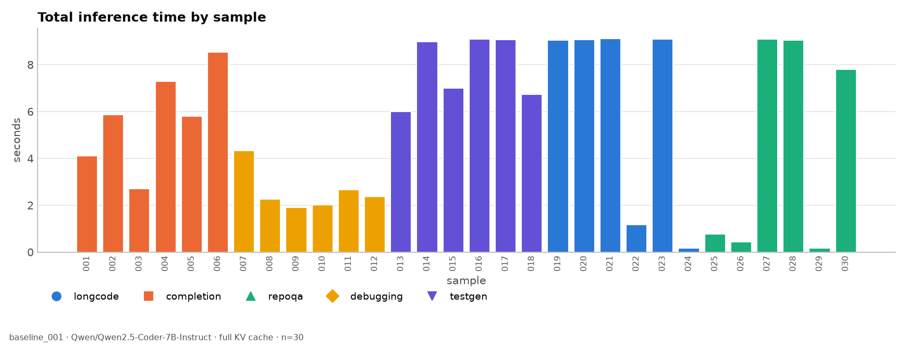
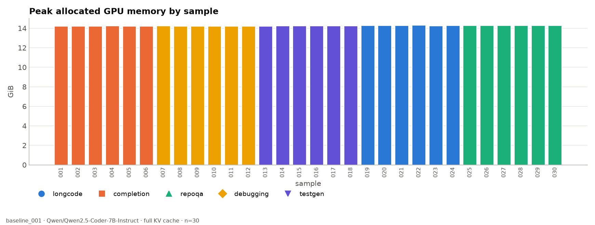
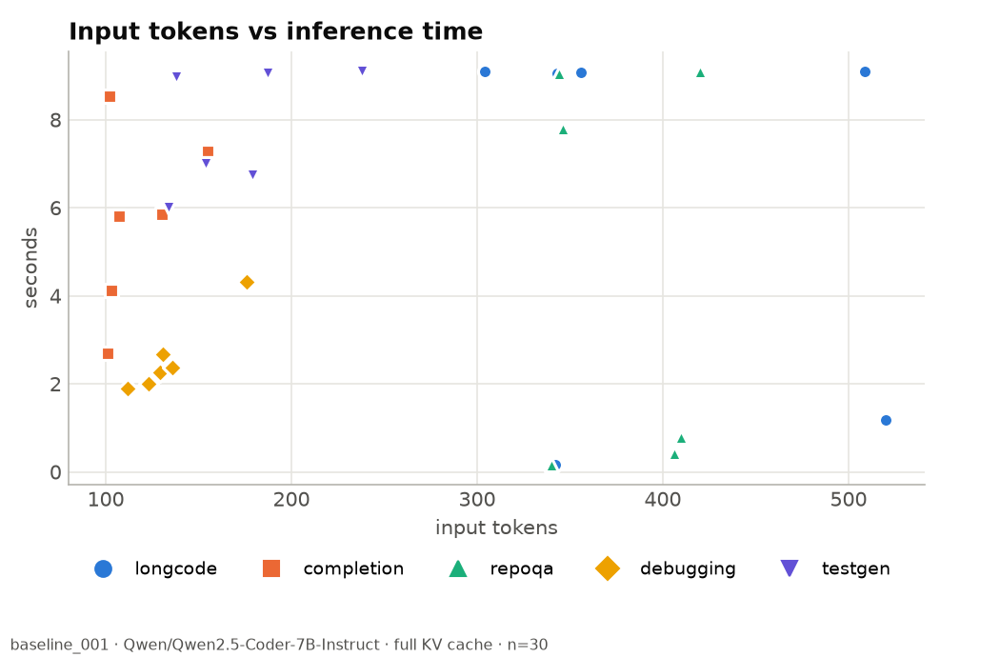
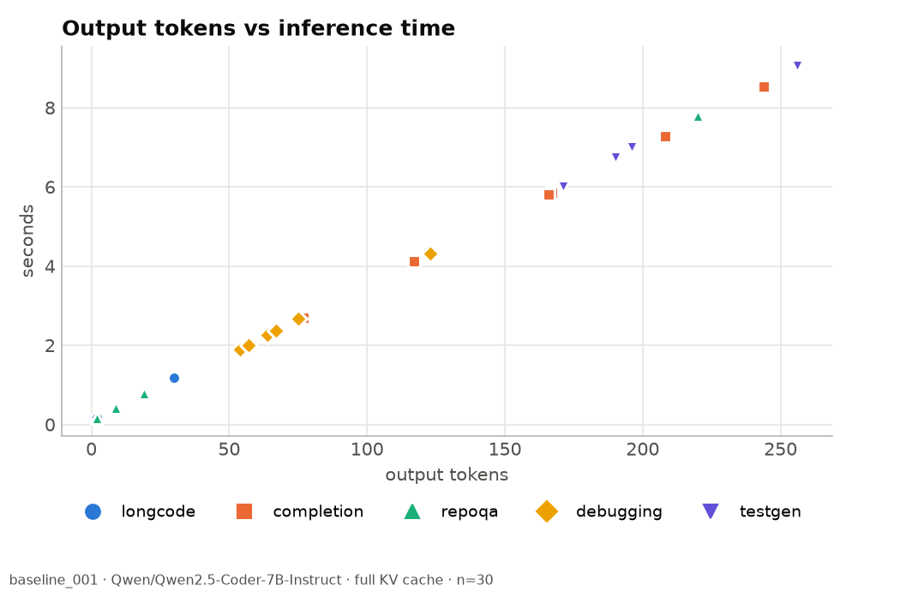
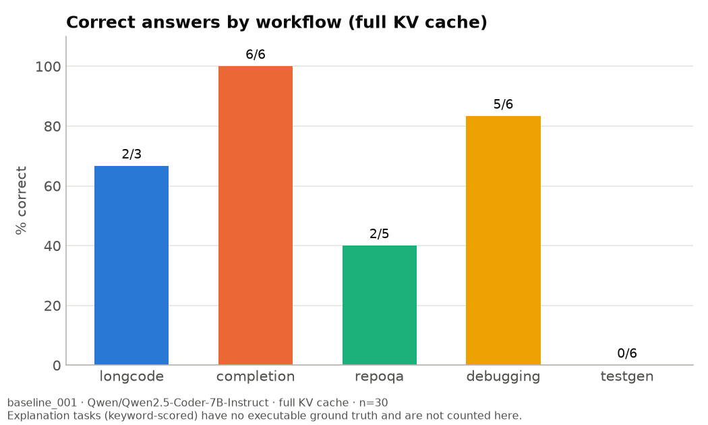

# Results summary: baseline_001

Model: `Qwen/Qwen2.5-Coder-7B-Instruct`. Cache method: full KV cache (no compression).

This is a 30-sample demonstration of the pipeline. It is not statistically conclusive, and no compression method has been evaluated, so no memory savings or quality retention are reported.

| metric | value |
|---|---|
| experiment_id | baseline_001 |
| model | Qwen/Qwen2.5-Coder-7B-Instruct |
| cache_method | full |
| num_samples | 30 |
| num_successful | 30 |
| num_failed | 0 |
| failed_by_status | {} |
| avg_input_tokens | 239.2 |
| avg_output_tokens | 152.1 |
| mean_inference_seconds | 5.39 |
| median_inference_seconds | 5.931 |
| mean_ttft_seconds | 0.0912 |
| mean_tpot_ms | 35.09 |
| mean_peak_allocated_gib | 14.239 |
| max_peak_allocated_gib | 14.291 |
| max_peak_reserved_gib | 14.348 |
| mean_kv_cache_mib | 21.3 |
| syntax_valid_pct | 88.9 |
| functional_correctness_pct | 57.7 |
| pass_at_1_pct | 61.1 |
| mean_decode_tokens_per_second | 28.5 |
| longcodeu_mean_score | None |
| functional_correctness_testable_n | 26 |
| unit_test_pass_rate_mean | 0.686 |

## By workflow

| workflow   |   n |   functional_correctness_pct |   syntax_valid_pct |   mean_keyword_coverage |   mean_inference_seconds |   mean_input_tokens |
|:-----------|----:|-----------------------------:|-------------------:|------------------------:|-------------------------:|--------------------:|
| completion |   6 |                        100   |              100   |                 nan     |                    5.716 |               116.3 |
| debugging  |   6 |                         83.3 |              100   |                 nan     |                    2.589 |               134.5 |
| longcode   |   6 |                         66.7 |              nan   |                   0.833 |                    6.278 |               395.7 |
| repoqa     |   6 |                         40   |              nan   |                   0.8   |                    4.554 |               377.7 |
| testgen    |   6 |                          0   |               66.7 |                 nan     |                    7.812 |               171.7 |

## Charts

