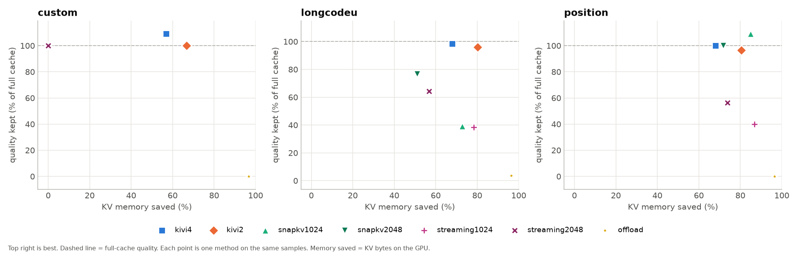
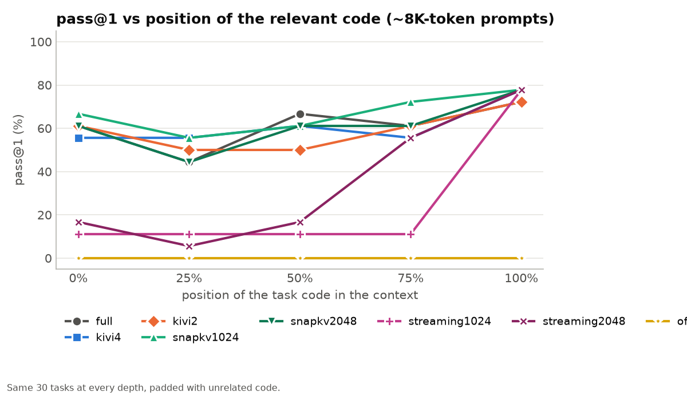

# KV-cache methods vs the full cache

Quality: pass@1 (% of executable tasks solved) for `custom` and `position`; mean LongCodeU score × 100 for `longcodeu`. Retention = method ÷ full × 100. Memory = KV-cache bytes actually stored at the end of generation, averaged over the compared samples; `kv_gpu_method_mib` is the part of it on the GPU (only smaller than `kv_method_mib` for `offload`, whose cache lives in CPU memory), and memory reduction is computed from it. `slowdown_x` = time per generated token ÷ the full cache's. `evicted_share_pct` = share of prompts where SnapKV / StreamingLLM actually dropped tokens (prompts shorter than the budget are left untouched).

Methods: `kivi4`/`kivi2` = 4/2-bit quantization; `snapkv<N>` = keep the N prompt tokens the question attends to; `streaming<N>` = keep the first 4 tokens + the most recent N-4 (StreamingLLM); `offload` = full cache kept in CPU memory, copied to the GPU layer by layer.

Small samples (30 custom tasks, 80 LongCodeU, 150 position prompts): differences of a few points are within noise.

| workload   | method        |   n_compared |   quality_full |   quality_method |   quality_retention_pct |   kv_full_mib |   kv_method_mib |   kv_gpu_method_mib |   memory_reduction_pct |   compression_ratio |   peak_gpu_gib_full |   peak_gpu_gib_method |   tpot_ms_full |   tpot_ms_method |   slowdown_x |   mean_input_tokens |   evicted_share_pct |
|:-----------|:--------------|-------------:|---------------:|-----------------:|------------------------:|--------------:|----------------:|--------------------:|-----------------------:|--------------------:|--------------------:|----------------------:|---------------:|-----------------:|-------------:|--------------------:|--------------------:|
| custom     | kivi4         |           30 |           61.1 |             66.7 |                   109.1 |          21.3 |             9.2 |                 9.2 |                   56.8 |                2.32 |               14.24 |                 14.23 |           35.1 |             37   |         1.05 |                 239 |                 nan |
| custom     | kivi2         |           30 |           61.1 |             61.1 |                   100   |          21.3 |             7.1 |                 7.1 |                   66.8 |                3.01 |               14.24 |                 14.23 |           35.1 |             37.8 |         1.08 |                 239 |                 nan |
| custom     | snapkv1024    |           30 |           61.1 |             61.1 |                   100   |          21.3 |            21.3 |                21.3 |                    0   |                1    |               14.24 |                 14.24 |           35.1 |             35.1 |         1    |                 239 |                   0 |
| custom     | snapkv2048    |           30 |           61.1 |             61.1 |                   100   |          21.3 |            21.3 |                21.3 |                    0   |                1    |               14.24 |                 14.24 |           35.1 |             35   |         1    |                 239 |                   0 |
| custom     | streaming1024 |           30 |           61.1 |             61.1 |                   100   |          21.3 |            21.3 |                21.3 |                    0   |                1    |               14.24 |                 14.24 |           35.1 |             35   |         1    |                 239 |                   0 |
| custom     | streaming2048 |           30 |           61.1 |             61.1 |                   100   |          21.3 |            21.3 |                21.3 |                    0   |                1    |               14.24 |                 14.24 |           35.1 |             35   |         1    |                 239 |                   0 |
| custom     | offload       |           30 |           61.1 |              0   |                     0   |          21.3 |            20.5 |                 0.7 |                   96.6 |               29.09 |               14.24 |                 14.23 |           35.1 |             36.9 |         1.05 |                 239 |                 nan |
| longcodeu  | kivi4         |           80 |           51.7 |             50.9 |                    98.5 |         258.8 |            83.1 |                83.1 |                   67.9 |                3.12 |               15.03 |                 14.87 |           36.5 |             42.1 |         1.15 |                4450 |                 nan |
| longcodeu  | kivi2         |           80 |           51.7 |             49.6 |                    96   |         258.8 |            51.1 |                51.1 |                   80.2 |                5.06 |               15.03 |                 14.83 |           36.5 |             43   |         1.18 |                4450 |                 nan |
| longcodeu  | snapkv1024    |           80 |           51.7 |             20.2 |                    39.1 |         258.8 |            70.6 |                70.6 |                   72.7 |                3.66 |               15.03 |                 14.84 |           36.5 |             35.3 |         0.97 |                4450 |                 100 |
| longcodeu  | snapkv2048    |           80 |           51.7 |             39.7 |                    76.7 |         258.8 |           126.7 |               126.7 |                   51.1 |                2.04 |               15.03 |                 14.91 |           36.5 |             35.6 |         0.98 |                4450 |                 100 |
| longcodeu  | streaming1024 |           80 |           51.7 |             19.9 |                    38.5 |         258.8 |            56   |                56   |                   78.4 |                4.62 |               15.03 |                 14.84 |           36.5 |             35.8 |         0.98 |                4450 |                 100 |
| longcodeu  | streaming2048 |           80 |           51.7 |             33.2 |                    64.2 |         258.8 |           112   |               112   |                   56.7 |                2.31 |               15.03 |                 14.91 |           36.5 |             36.5 |         1    |                4450 |                 100 |
| longcodeu  | offload       |           80 |           51.7 |              1.9 |                     3.7 |         258.8 |           271.3 |                 9.7 |                   96.3 |               26.71 |               15.03 |                 14.8  |           36.5 |             59.3 |         1.62 |                4450 |                 nan |
| position   | kivi4         |          150 |           61.1 |             61.1 |                   100   |         425.8 |           135.9 |               135.9 |                   68.1 |                3.13 |               15.62 |                 15.36 |           37.7 |             47.2 |         1.25 |                7631 |                 nan |
| position   | kivi2         |          150 |           61.1 |             58.9 |                    96.4 |         425.8 |            83.2 |                83.2 |                   80.5 |                5.12 |               15.62 |                 15.3  |           37.7 |             48   |         1.27 |                7631 |                 nan |
| position   | snapkv1024    |          150 |           61.1 |             66.7 |                   109.1 |         425.8 |            64.4 |                64.4 |                   84.9 |                6.61 |               15.62 |                 15.27 |           37.7 |             35.4 |         0.94 |                7631 |                 100 |
| position   | snapkv2048    |          150 |           61.1 |             61.1 |                   100   |         425.8 |           120.3 |               120.3 |                   71.7 |                3.54 |               15.62 |                 15.32 |           37.7 |             35.6 |         0.94 |                7631 |                 100 |
| position   | streaming1024 |          150 |           61.1 |             24.4 |                    40   |         425.8 |            56   |                56   |                   86.8 |                7.6  |               15.62 |                 15.27 |           37.7 |             35.9 |         0.95 |                7631 |                 100 |
| position   | streaming2048 |          150 |           61.1 |             34.4 |                    56.4 |         425.8 |           112   |               112   |                   73.7 |                3.8  |               15.62 |                 15.32 |           37.7 |             36.5 |         0.97 |                7631 |                 100 |
| position   | offload       |          150 |           61.1 |              0   |                     0   |         425.8 |           431.3 |                15.4 |                   96.4 |               27.64 |               15.62 |                 15.23 |           37.7 |             75.3 |         2    |                7631 |                 nan |

## Position test: pass@1 by depth of the relevant code

| method        |    0 |   25 |   50 |   75 |   100 |
|:--------------|-----:|-----:|-----:|-----:|------:|
| full          | 61.1 | 44.4 | 66.7 | 61.1 |  72.2 |
| kivi2         | 61.1 | 50   | 50   | 61.1 |  72.2 |
| kivi4         | 55.6 | 55.6 | 61.1 | 55.6 |  77.8 |
| offload       |  0   |  0   |  0   |  0   |   0   |
| snapkv1024    | 66.7 | 55.6 | 61.1 | 72.2 |  77.8 |
| snapkv2048    | 61.1 | 44.4 | 61.1 | 61.1 |  77.8 |
| streaming1024 | 11.1 | 11.1 | 11.1 | 11.1 |  77.8 |
| streaming2048 | 16.7 |  5.6 | 16.7 | 55.6 |  77.8 |

## Charts

