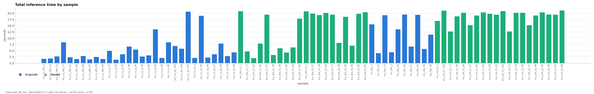
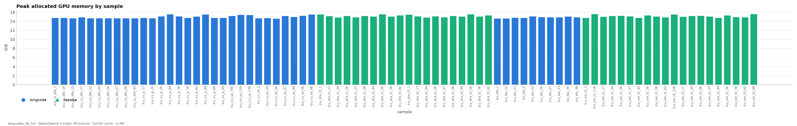
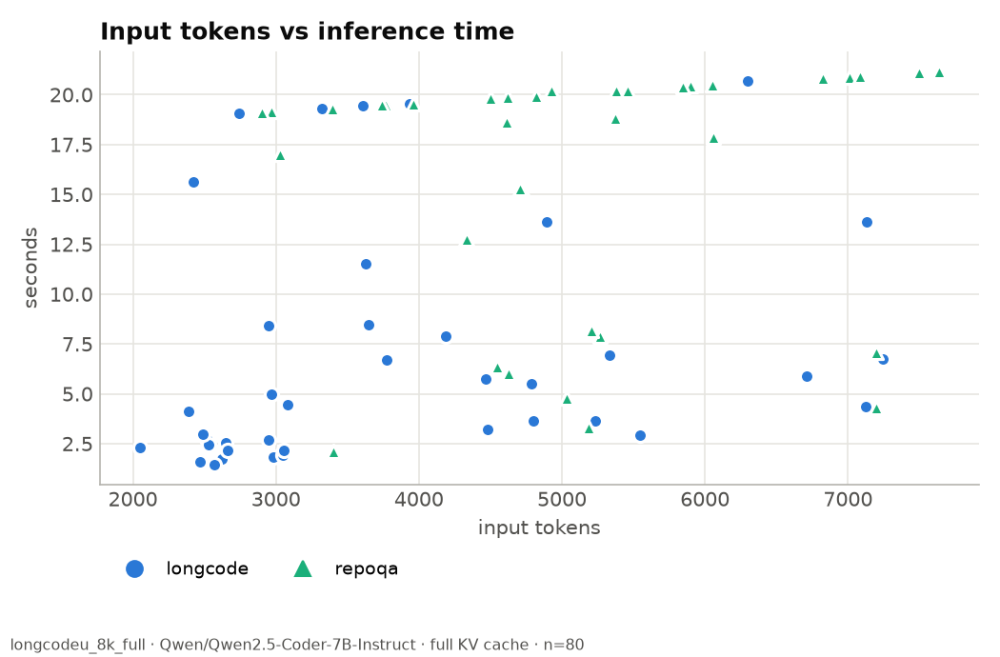
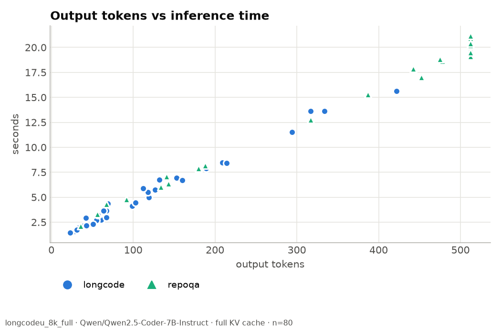
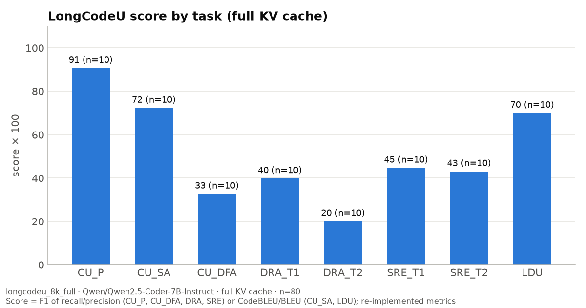

# Results summary: longcodeu_8k_full

Model: `Qwen/Qwen2.5-Coder-7B-Instruct`. Cache method: full KV cache (no compression).

This is a 80-sample demonstration of the pipeline. It is not statistically conclusive, and no compression method has been evaluated, so no memory savings or quality retention are reported.

| metric | value |
|---|---|
| experiment_id | longcodeu_8k_full |
| model | Qwen/Qwen2.5-Coder-7B-Instruct |
| cache_method | full |
| num_samples | 80 |
| num_successful | 80 |
| num_failed | 0 |
| failed_by_status | {} |
| avg_input_tokens | 4450.3 |
| avg_output_tokens | 282.8 |
| mean_inference_seconds | 11.457 |
| median_inference_seconds | 9.982 |
| mean_ttft_seconds | 1.1361 |
| mean_tpot_ms | 36.5 |
| mean_peak_allocated_gib | 15.026 |
| max_peak_allocated_gib | 15.618 |
| max_peak_reserved_gib | 15.992 |
| mean_kv_cache_mib | 258.8 |
| syntax_valid_pct | None |
| functional_correctness_pct | None |
| pass_at_1_pct | None |
| mean_decode_tokens_per_second | 27.41 |
| longcodeu_mean_score | 0.5171 |
| functional_correctness_testable_n | 0 |
| unit_test_pass_rate_mean | None |

## By workflow

| workflow   |   n | functional_correctness_pct   | syntax_valid_pct   | mean_keyword_coverage   |   mean_inference_seconds |   mean_input_tokens |
|:-----------|----:|:-----------------------------|:-------------------|:------------------------|-------------------------:|--------------------:|
| longcode   |  40 |                              |                    |                         |                    6.904 |              3847.8 |
| repoqa     |  40 |                              |                    |                         |                   16.01  |              5052.8 |

## Charts

