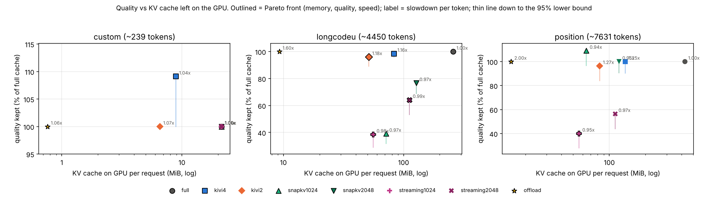

# Quality-aware recommender: Pareto fronts and example choices

Generated by `python main.py recommend --report` from the runs in `results/json/` (Qwen2.5-Coder-7B-Instruct, A10G 24 GB). Quality retention = method ÷ full cache × 100 on the same samples; *low* = 95 % lower confidence bound from a paired bootstrap. GPU KV = KV-cache bytes left on the GPU per request. Slowdown = time per generated token ÷ the full cache's.

## Pareto front per workload (at the measured prompt length)

A method is on the front when no other method is at the same time smaller on the GPU, at least as good in quality and at least as fast. Everything off the front is never the best choice.

### custom: short coding tasks (~240-token prompts), prompt ≈ 239 tokens

| method | quality kept | low | GPU KV / request | KV saved | slowdown | on front |
|:--|--:|--:|--:|--:|--:|:-:|
| offload | 100% | 100% | 1 MiB | 96% | 1.06x | ● |
| kivi2 | 100% | 100% | 7 MiB | 69% | 1.07x |  |
| kivi4 | 109% | 100% | 9 MiB | 58% | 1.04x | ● |
| full | 100% | 100% | 21 MiB | 0% | 1.00x | ● |
| snapkv1024 | 100% | 100% | 21 MiB | 0% | 1.00x | ● |
| snapkv2048 | 100% | 100% | 21 MiB | 0% | 1.00x | ● |
| streaming1024 | 100% | 100% | 21 MiB | 0% | 1.01x |  |
| streaming2048 | 100% | 100% | 21 MiB | 0% | 1.01x |  |

### longcodeu: long-code understanding, LongCodeU 0-8K (~4.5K tokens), prompt ≈ 4450 tokens

| method | quality kept | low | GPU KV / request | KV saved | slowdown | on front |
|:--|--:|--:|--:|--:|--:|:-:|
| offload | 100% | 100% | 9 MiB | 96% | 1.60x | ● |
| kivi2 | 96% | 89% | 51 MiB | 80% | 1.18x | ● |
| streaming1024 | 38% | 29% | 56 MiB | 78% | 0.98x | ● |
| snapkv1024 | 39% | 32% | 71 MiB | 72% | 0.97x | ● |
| kivi4 | 98% | 96% | 83 MiB | 68% | 1.16x | ● |
| streaming2048 | 64% | 53% | 112 MiB | 57% | 0.99x | ● |
| snapkv2048 | 77% | 69% | 127 MiB | 51% | 0.97x | ● |
| full | 100% | 100% | 259 MiB | 0% | 1.00x | ● |

### position: find the relevant code inside an ~8K-token file, prompt ≈ 7631 tokens

| method | quality kept | low | GPU KV / request | KV saved | slowdown | on front |
|:--|--:|--:|--:|--:|--:|:-:|
| offload | 100% | 100% | 15 MiB | 96% | 2.00x | ● |
| streaming1024 | 40% | 28% | 56 MiB | 87% | 0.95x | ● |
| snapkv1024 | 109% | 96% | 64 MiB | 85% | 0.94x | ● |
| kivi2 | 96% | 84% | 83 MiB | 80% | 1.27x |  |
| streaming2048 | 56% | 44% | 112 MiB | 74% | 0.97x |  |
| snapkv2048 | 100% | 91% | 120 MiB | 72% | 0.95x |  |
| kivi4 | 100% | 90% | 136 MiB | 68% | 1.25x |  |
| full | 100% | 100% | 426 MiB | 0% | 1.00x |  |

## What the recommender picks

Every scenario assumes 7 GiB of GPU memory free for KV caches (A10G after loading the 7B model).

| scenario | custom | longcodeu | position |
|:--|:--|:--|:--|
| One user, no speed limit | **offload** (96% less KV, 1.06x) | **offload** (96% less KV, 1.60x) | **offload** (96% less KV, 2.00x) |
| Interactive: at most 30% slower | **offload** (96% less KV, 1.06x) | **kivi2** (80% less KV, 1.18x) | **snapkv1024** (85% less KV, 0.94x) |
| Same, quality guaranteed (95% lower bound) | **offload** (96% less KV, 1.06x) | **kivi4** (68% less KV, 1.16x) | **snapkv1024** (85% less KV, 0.94x) |
| Busy server: 32 requests at once, ≤30% slower | **offload** (96% less KV, 1.06x) | **kivi2** (80% less KV, 1.18x) | **snapkv1024** (85% less KV, 0.94x) |
| Quality can drop to 75%, ≤10% slower | **offload** (96% less KV, 1.06x) | **snapkv2048** (51% less KV, 0.97x) | **snapkv1024** (85% less KV, 0.94x) |

Why these answers:

- With no speed limit, CPU offloading always wins: it keeps the exact answers and leaves only one layer of the cache on the GPU, but each token is up to 2x slower on long prompts.
- With a speed limit, KIVI is the safe choice for long-code understanding; SnapKV wins on the position test, where the question tells it which code to keep. StreamingLLM is never chosen at 95 %, because it drops the middle of the context.
- On short prompts (custom) the eviction methods change nothing, because the prompt fits in the budget.
- *Quality guaranteed* uses the 95 % lower confidence bound instead of the average, so a method only passes if the samples show it reliably keeps 95 %. On LongCodeU this moves the choice from 2-bit to 4-bit KIVI, because 2-bit KIVI's bound is below 95 % even though its average is 96 %.

## Check: memory model vs measured

The recommender predicts GPU KV bytes for any prompt length from a formula per method (`recommender/profiles.py`). Here the formula is applied to each measured sample and compared with what was measured.

Bytes per cached token (measured): 57,344; layers: 28.

| workload | method | measured MiB | predicted MiB | error |
|:--|:--|--:|--:|--:|
| custom | full | 21.3 | 21.3 | +0.0% |
| custom | streaming1024 | 21.3 | 21.3 | +0.0% |
| custom | streaming2048 | 21.3 | 21.3 | +0.0% |
| custom | snapkv1024 | 21.3 | 21.3 | +0.0% |
| custom | offload | 0.8 | 0.8 | +0.0% |
| custom | kivi2 | 7.1 | 6.6 | -7.0% |
| custom | kivi4 | 9.2 | 8.9 | -3.1% |
| custom | snapkv2048 | 21.3 | 21.3 | +0.0% |
| longcodeu | full | 258.8 | 258.8 | +0.0% |
| longcodeu | kivi4 | 83.1 | 83.3 | +0.3% |
| longcodeu | streaming1024 | 56.0 | 56.0 | +0.0% |
| longcodeu | snapkv1024 | 70.6 | 70.6 | +0.0% |
| longcodeu | kivi2 | 51.1 | 51.5 | +0.8% |
| longcodeu | offload | 9.2 | 9.2 | +0.0% |
| longcodeu | snapkv2048 | 126.7 | 126.7 | +0.0% |
| longcodeu | streaming2048 | 112.0 | 112.0 | +0.0% |
| position | kivi2 | 83.2 | 83.0 | -0.1% |
| position | kivi4 | 135.9 | 135.8 | -0.1% |
| position | snapkv1024 | 64.4 | 64.4 | +0.0% |
| position | streaming2048 | 112.0 | 112.0 | +0.0% |
| position | full | 425.8 | 425.8 | +0.0% |
| position | offload | 15.2 | 15.2 | +0.0% |
| position | streaming1024 | 56.0 | 56.0 | +0.0% |
| position | snapkv2048 | 120.3 | 120.3 | +0.0% |

Limits: three workloads and one model, at most ~8K tokens. Beyond the measured prompt lengths the quality of KIVI/SnapKV/StreamingLLM is extrapolated and the output marks it with ⚠. Rerun the benchmarks at 16K/32K and the recommender picks them up automatically.

